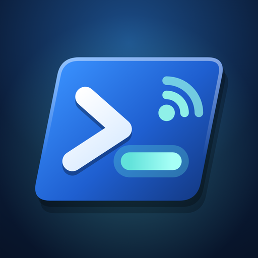
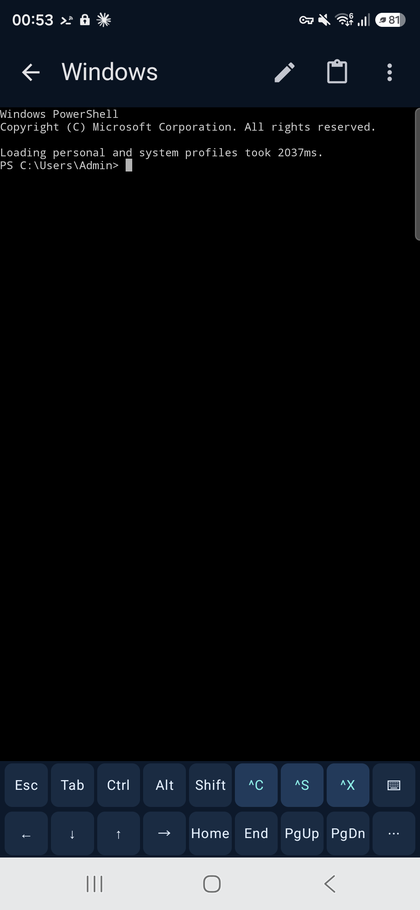
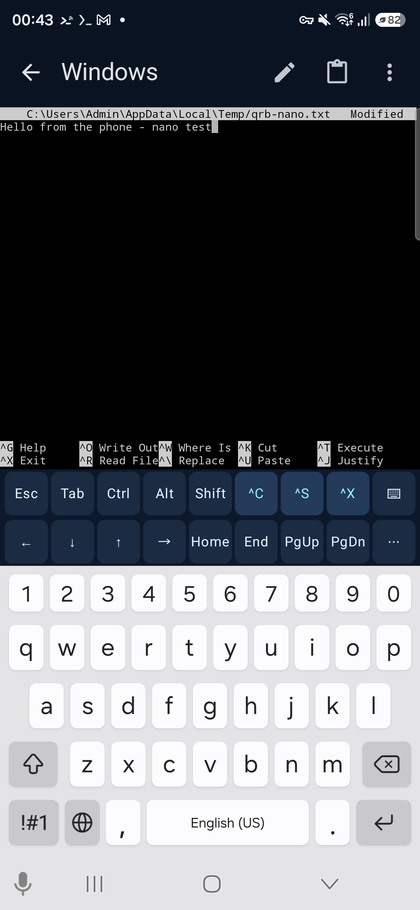
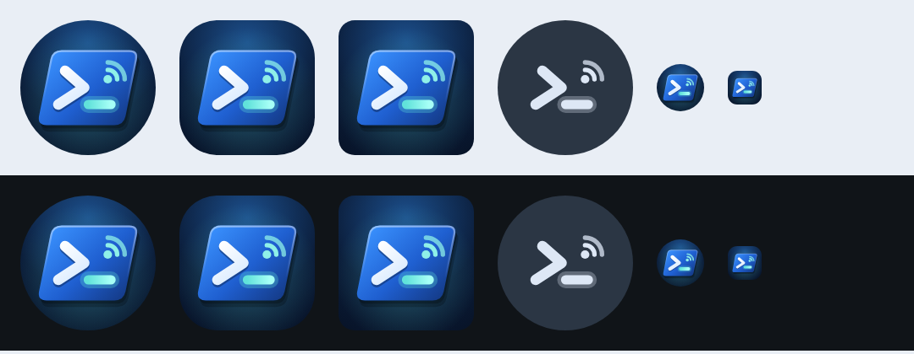
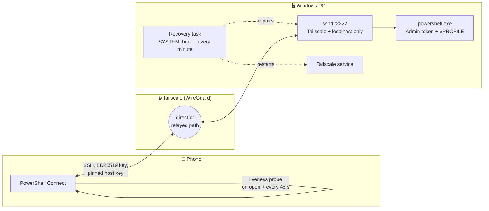
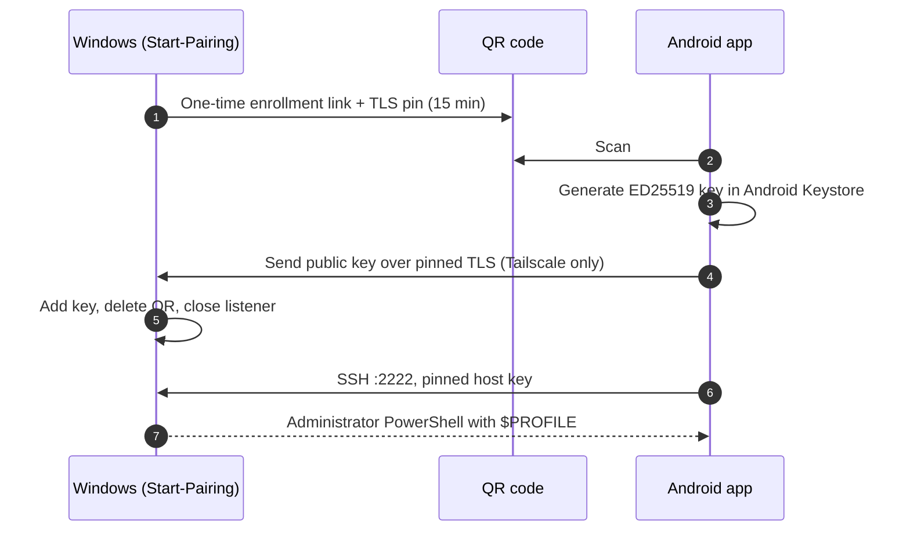

<div align="center">



# PowerShell Connect

**Your PC's real Administrator PowerShell, in your pocket.**

A native Android terminal that opens straight into Windows PowerShell 5.1 on your PC, with your own profile loaded, from any network in the world, and reconnects by itself.

[](https://github.com/Michaelunkai/qr-powershell-connect/releases/latest)
[](https://github.com/Michaelunkai/qr-powershell-connect/releases/latest/download/PowerShell-Connect-2.0.2.apk)
[](#1-set-up-the-pc)
[](#3-set-up-the-phone)
[](https://github.com/Michaelunkai/qr-powershell-connect/actions/workflows/ci.yml)
[](#license)

[Download](#download) · [Quick start](#quick-start) · [Using it](#using-it) · [Troubleshooting](#troubleshooting) · [How it works](#how-it-works)

</div>

---

<table>
<tr>
<td width="33%" align="center"><br><sub><b>Straight into your profile</b><br>Elevated PowerShell 5.1, profile loaded</sub></td>
<td width="33%" align="center"><br><sub><b>Full-screen editors</b><br>nano with ^S / ^X one tap away</sub></td>
<td width="33%" align="center"><br><sub><b>Adaptive icon</b><br>Every launcher shape, light and dark</sub></td>
</tr>
</table>

## Why

Remote desktop apps are heavy, and generic SSH clients need setup, port forwarding and passwords. PowerShell Connect is built for a single job: **tap the icon and you're at your PC's admin prompt**.

| | |
|---|---|
| ⚡ **One tap** | Opens directly into the PC's shell. No host list, no login screen. |
| 🛡️ **Real admin shell** | Windows PowerShell 5.1 with a full Administrator token and your normal `$PROFILE`, not a restricted remote session. |
| 🌍 **Works anywhere** | Wi-Fi, mobile data, hotel networks. Traffic goes through your private [Tailscale](https://tailscale.com) network, with no ports opened on your router. |
| 🔁 **Heals itself** | Spots a dead connection within seconds and reconnects. The PC side repairs its own SSH listener and Tailscale every minute. |
| 📱 **Made for phones** | A two-row key bar (Esc, Tab, Ctrl, Alt, Shift, arrows, ^C/^S/^X) and a sheet of nano, PSReadLine and F-keys. |
| 🔐 **Paired with one QR** | The phone makes its own key inside Android Keystore. The PC's host key is pinned. Pairing QR codes expire and work only once. |

## Download

| Component | Get it |
|---|---|
| 📱 **Android app** (signed APK) | [`PowerShell-Connect-2.0.2.apk`](https://github.com/Michaelunkai/qr-powershell-connect/releases/latest/download/PowerShell-Connect-2.0.2.apk) |
| 🖥️ **PC setup** (scripts) | [`PowerShell-Connect-2.0.2-pc-setup.zip`](https://github.com/Michaelunkai/qr-powershell-connect/releases/latest/download/PowerShell-Connect-2.0.2-pc-setup.zip) |
| 🔎 **Checksums** | [`SHA256SUMS.txt`](https://github.com/Michaelunkai/qr-powershell-connect/releases/latest/download/SHA256SUMS.txt) |

All versions are on the [releases page](https://github.com/Michaelunkai/qr-powershell-connect/releases).

## Quick start

You need a Windows 10/11 PC, an Android phone (7.0 or newer) and a free [Tailscale](https://tailscale.com) account. Setup takes about ten minutes, once.

### 1. Set up the PC

Extract `PowerShell-Connect-2.0.2-pc-setup.zip`. Open **Windows PowerShell as Administrator** in that folder and run:

```powershell
Set-ExecutionPolicy -Scope Process Bypass -Force
.\Setup.ps1 -Distribution GitHubZipPreview -IngressPolicy MeshBind
```

This will:

- install Tailscale (if needed) and ask you to sign in once;
- install a Microsoft-signed OpenSSH server on port 2222, listening **only** on Tailscale and localhost;
- make Windows PowerShell the SSH shell, with key-only login for your account;
- register a hidden SYSTEM recovery task that keeps everything running after reboots and network changes;
- run a real loopback login and confirm it gets an Administrator token.

> [!TIP]
> On a healthy Windows install, plain `.\Setup.ps1` uses the built-in OpenSSH feature and a Tailscale-only firewall rule. The `GitHubZipPreview` + `MeshBind` mode shown above is the most robust option: it needs no Windows feature servicing and no firewall changes.

### 2. Make it last forever (two Tailscale settings)

These two settings are what keep it working after months away. Only you can change them.

1. **Turn off key expiry for the PC.** In the [Tailscale admin console → Machines](https://login.tailscale.com/admin/machines), open your PC's `⋯` menu and choose **Disable key expiry**. Otherwise the PC drops off your network when its key expires (about every 180 days).
2. **Make Tailscale an Always-on VPN on the phone.** Go to Android **Settings → Network & internet → VPN → Tailscale ⚙ → Always-on VPN: On**. Android can then never quietly stop Tailscale in the background.

### 3. Set up the phone

1. Install **Tailscale** from Google Play and sign in with the **same account** as the PC.
2. Download and install [`PowerShell-Connect-2.0.2.apk`](https://github.com/Michaelunkai/qr-powershell-connect/releases/latest/download/PowerShell-Connect-2.0.2.apk). Allow the install from your browser if Android asks.
3. Allow notifications when the app first opens. A small notification keeps your session alive in the background.

### 4. Pair once

On the PC (elevated):

```powershell
.\windows\Start-Pairing.ps1
```

In the app, tap **Scan QR** and point it at the code. That's it. From now on, the home-screen icon opens your PowerShell directly.

## Using it

### The key bar

```
┌─────┬─────┬──────┬─────┬───────┬────┬────┬────┬───┐
│ Esc │ Tab │ Ctrl │ Alt │ Shift │ ^C │ ^S │ ^X │ ⌨ │
├─────┼─────┼──────┼─────┼───────┼────┼────┼────┼───┤
│  ←  │  ↓  │  ↑   │  →  │ Home  │End │PgUp│PgDn│ ⋯ │
└─────┴─────┴──────┴─────┴───────┴────┴────┴────┴───┘
```

- **Ctrl / Alt / Shift:** tap once for the next key only, or hold to lock (shown with `•`). Tap again to release.
- **^C** interrupts, and **^S / ^X** save and exit in nano.
- **⌨** shows or hides the phone keyboard.
- **⋯** opens the full key sheet:

| Section | Keys |
|---|---|
| **nano** | ^O Write · ^W Find · ^\ Replace · ^_ Go to line · ^K Cut · ^U Paste · M-U Undo · M-E Redo · M-A Mark · M-6 Copy · ^G Help · M-# Line numbers |
| **PowerShell** | ^R History search · ^L Clear · ⇧Tab Previous completion · ^Space Completion menu · ^D End of input · ^Z Undo · Ins · Del |
| **Function keys** | F1 – F12 |
| **Symbols** | <code>&#124; \ / ~ - $ &#96; { } @ [ ] ' " # &lt; &gt; &amp; ; %</code> |

### Everyday tips

- Select terminal text to copy it. The 📋 button in the top bar pastes. (Ctrl+C sends an interrupt, not a copy.)
- Pair once with **Scan QR**, or paste a pairing link if the camera isn't handy.
- Leave the app whenever you like. The session keeps running in the background with a notification, and you come back to the same prompt.
- Run anything you would run at your desk: `nano`, `winget`, `git`, `Get-Service`, `Restart-Computer`, your own profile functions.

## Reliability by design



| Failure | What happens automatically |
|---|---|
| Phone changes network (Wi-Fi ↔ mobile) | Tailscale moves the path and the app reconnects after a short grace period. |
| PC stops answering but TCP still looks open | The app's probe gets no reply within 10 s, drops the link and redials. Tested at about 25 s from freeze to fresh prompt. |
| PC reboots | The SSH service starts at boot with no user logged in. The recovery task re-binds the listener once Tailscale has its address. |
| Tailscale or sshd stopped or disabled | The recovery task re-enables and restarts them within a minute. |
| sshd crashes | Windows Service Control Manager restarts it after 5, 15 and 60 seconds. |
| App killed by Android | Opening the icon starts a fresh session with your profile. It even asks Tailscale to connect if the VPN is down. |

## Troubleshooting

| Symptom | Fix |
|---|---|
| `ECONNREFUSED` / "connection refused" | The PC's listener is down. Wait a minute for the recovery task, or run `.\windows\Repair-Bridge.ps1` as Administrator. Check with `.\windows\Test-Bridge.ps1 -Loopback`. |
| Connection times out | Make sure Tailscale is connected on **both** devices with the same account, and that the PC is awake (Settings → Power → Sleep: Never while plugged in). |
| Worked for months, then stopped | The PC's Tailscale key probably expired. Run `tailscale up` on the PC, then turn off key expiry (step 2 above). |
| Stops working when the phone is idle | Turn on Always-on VPN for Tailscale, and set both apps' Battery usage to **Unrestricted**. |
| "Host key changed" warning | The PC's SSH host key changed (for example after a reinstall). Pair again with `Start-Pairing.ps1`. |
| Need to remove a phone | `.\windows\Revoke-Key.ps1 -PublicKey '<the phone key>'` |
| Uninstall everything from the PC | `.\windows\Uninstall-Bridge.ps1` rolls back exactly what setup changed. |

Logs are in `%ProgramData%\QrPowerShellConnect\` (`operations.log`, `recovery.log`, `sshd.log`) and in `%ProgramData%\ssh\logs\`.

## How it works



| Part | Technology |
|---|---|
| Android app | Kotlin + Jetpack Compose, based on [ConnectBot](https://github.com/connectbot/connectbot) (Apache-2.0), sshlib/trilead SSH, Android Keystore |
| Transport | [Tailscale](https://tailscale.com) WireGuard mesh, direct or DERP-relayed |
| PC server | Microsoft Win32-OpenSSH (signature- and hash-verified), `DefaultShell` = Windows PowerShell 5.1 |
| Pairing | Python (`qrbridge.py`): single-use token, certificate-pinned TLS, bound to the Tailscale IP only |
| Self-healing | `Repair-Bridge.ps1` as a SYSTEM scheduled task, plus SCM failure actions |

### Repository layout

```
android-app/        Native Android app (Gradle, Kotlin/Compose)
windows/            PC install, pairing, repair, test, revoke and uninstall scripts
qrbridge.py         Pairing server and QR generator
Setup.ps1           One-command PC setup
android/            Legacy Termux client (optional)
docs/               Architecture, Android guide and validation records
tests/              Python unit tests
```

More detail: [architecture](docs/architecture.md) · [native Android guide](docs/NATIVE-ANDROID.md) · [validation records](docs/NATIVE-VALIDATION.md) · [security boundary](SECURITY.md)

## Build from source

```powershell
# Android APK (JDK 17 + Android SDK). Signing key is read from %ProgramData%, never from the repo.
.\windows\Build-NativeApp.ps1 -Action Release   # -> dist\PowerShell-Connect-2.0.2.apk
.\windows\Build-NativeApp.ps1 -Action Test

# Python pairing tools
py -3 -m venv .venv; .\.venv\Scripts\python.exe -m pip install -e .
.\.venv\Scripts\python.exe -m unittest discover -s tests -v
```

## Security

- SSH accepts **public keys only** for one named Administrators account, on port 2222, bound to Tailscale and localhost. Nothing is exposed to the internet or your LAN.
- The phone's private key never leaves Android Keystore. The PC's host key is pinned during pairing.
- Pairing QR codes are single-use administrator capabilities that expire. Treat one like a password until it's used.
- Agent, TCP and X11 forwarding are disabled. There is no password or keyboard-interactive login.

See [SECURITY.md](SECURITY.md) for the full boundary and how to report issues.

## License

Host tools: [MIT](LICENSE). Android app: Apache-2.0 (ConnectBot-derived). See [THIRD_PARTY_NOTICES.md](THIRD_PARTY_NOTICES.md).

<div align="center"><sub>Made for people who want their own PC's shell, everywhere.</sub></div>
